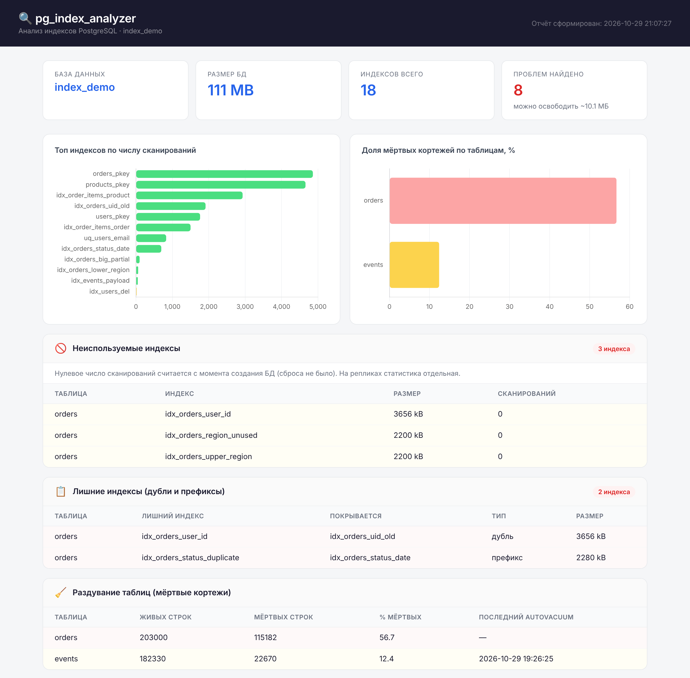

# pg_index_analyzer

Утилита на Python для аудита индексов PostgreSQL. Подключается к базе только на чтение, анализирует системную статистику и показывает, какие индексы не используются, какие дублируют друг друга, где таблицам не хватает индексов и где накопились мёртвые строки. Результат выводится в терминал и в HTML-отчёт с графиками.



## Что проверяется

| Проверка | Что ищет | Источник данных |
|---|---|---|
| Неиспользуемые индексы | Индексы без единого сканирования. PK, UNIQUE и индексы под ограничения не учитываются | `pg_stat_user_indexes`, `pg_index` |
| Лишние индексы | Полные дубли (те же колонки, opclass, collation, выражения, условие, тип) и btree-префиксы: `(a)` при наличии `(a, b)`. Из пары дублей к удалению предлагается менее используемый | `pg_index` |
| Раздувание таблиц | Доля мёртвых версий строк после UPDATE и DELETE | `pg_stat_user_tables` |
| Отсутствующие индексы | Крупные таблицы, которые чаще читаются целиком (Seq Scan), чем по индексу, в том числе таблицы вообще без индексов | `pg_stat_user_tables` |
| Кэш индексов | Доля чтений индекса из памяти, а не с диска | `pg_statio_user_indexes` |
| Статистика использования | Все индексы с числом сканирований и статусом: активно, умеренно, редко, не используется, ограничение | `pg_stat_user_indexes` |

Строки в отчёте подсвечиваются по серьёзности (жёлтый — предупреждение, красный — критично). Пороги одинаковые для терминала и HTML и задаются константами в начале `main.py`.

## Как это устроено

```
main.py  ──►  report_data.js  ──►  report.html
(сбор данных      (результаты          (страница строит
 и терминал)       в формате JSON)      таблицы и графики)
```

- `main.py` выполняет SQL-запросы к системным представлениям, печатает отчёт в терминал и сохраняет результаты в `report_data.js`.
- `report.html` ничего не считает сам: он подключает `report_data.js` и строит по нему таблицы и графики (Chart.js). Открывается двойным кликом, сервер не нужен.

Подключение выполняется в режиме read-only, поэтому анализатор ничего не меняет в базе.

## Требования

- Python 3.8+
- PostgreSQL 12+ (проверено на 16 и 18)
- Библиотека `psycopg2-binary`

## Установка и запуск

1. Установите зависимость:

   ```
   pip install psycopg2-binary
   ```

2. Создайте рядом с `main.py` файл `db.ini` с параметрами подключения. Файл не хранится в репозитории, поэтому пароль не попадает в git:

   ```ini
   [database]
   host = localhost
   port = 5432
   dbname = my_database
   user = postgres
   password = ваш_пароль
   ```

   Если оставить `password` пустым, пароль возьмётся из переменной окружения `PGPASSWORD` или из файла `pgpass.conf`.

3. Запустите анализатор:

   ```
   python main.py
   ```

4. Откройте `report.html` в браузере. После каждого нового запуска достаточно обновить страницу.

### Параметры командной строки

Любой параметр подключения, кроме пароля, можно переопределить при запуске:

```
python main.py --dbname other_db --host 192.168.1.10 --port 5433 --user admin
python main.py --config path/to/other.ini   # другой файл настроек
python main.py --no-report                  # только вывод в терминал
```

## Ограничения

- Счётчики сканирований накапливаются с момента последнего сброса статистики (`pg_stat_reset()`), а на репликах статистика своя. Индекс, который не используется на основном сервере, может быть нужен на реплике.
- Раздувание считается по мёртвым строкам таблиц. Точная оценка раздувания самих индексов требует расширения `pgstattuple`.
- Для графиков нужен интернет: библиотека Chart.js загружается из CDN. Без интернета таблицы отображаются, а графики нет.

## Структура проекта

```
main.py          анализатор
report.html      страница отчёта
report_data.js   данные последнего запуска (создаётся main.py)
docs/report.png  скриншот отчёта
```
